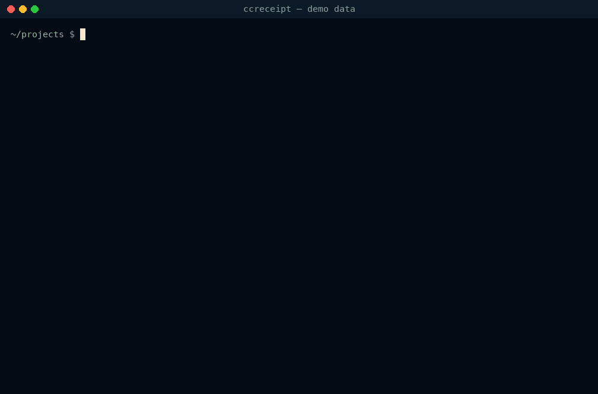
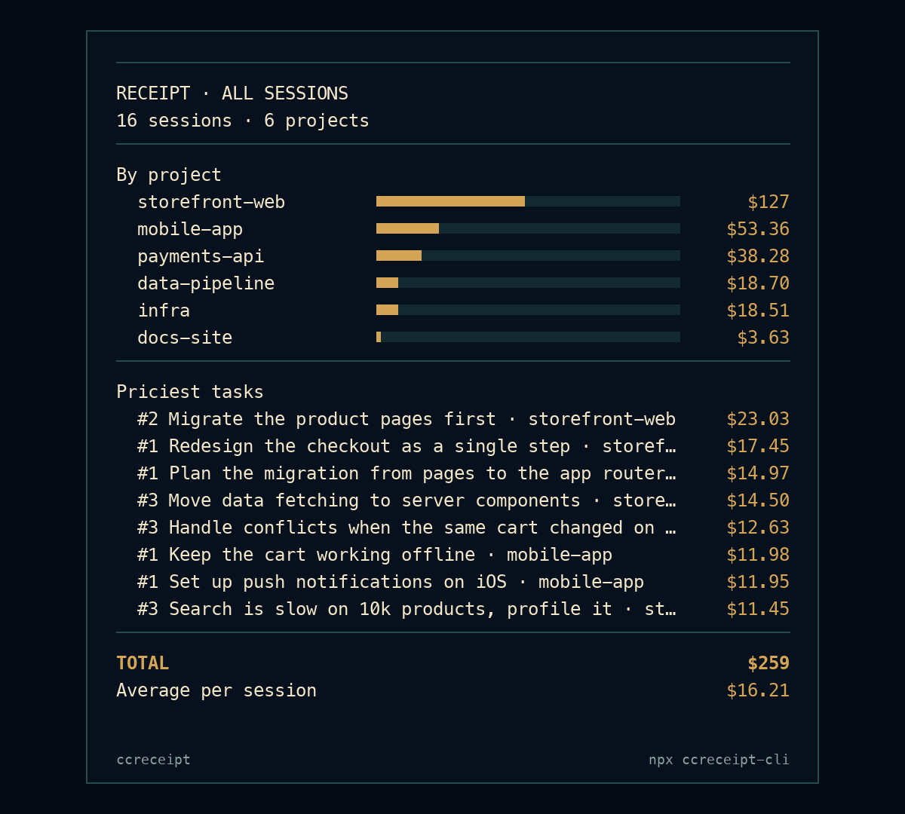

# ccreceipt

[](https://www.npmjs.com/package/ccreceipt-cli)
[](https://github.com/thehorizoncompany/ccreceipt-cli/actions/workflows/test.yml)
[](LICENSE)

**The itemized receipt for your Claude Code and OpenAI Codex CLI sessions.** What each task cost, which tool result you kept paying to re-read, and what the same tokens would cost on another model. Local, zero dependencies: your sessions never leave your machine.



<sub>Recorded on an invented history: every project, prompt and amount above is made up.</sub>

## Quick start

```
npx ccreceipt-cli
```

Also `bunx ccreceipt-cli`, `pnpm dlx ccreceipt-cli` or `yarn dlx ccreceipt-cli`. Node 18+ or Bun, nothing to configure, no account. Installed globally (`npm i -g ccreceipt-cli`), the command is `ccreceipt`, the name used below.

## What it tells you

`ccusage` tells you what you spent per day. Neither it nor your bill tells you **where** the money went inside a session: which prompt, which tool call, which 40 KB file read in minute 3 and paid for again on each of the next 500 API calls.

- **Cost per task.** Every prompt you typed, with everything it triggered (tool calls, sub-agents), priced and attributed to it.
- **Carrying cost of a tool result.** A result is paid once to write it to the cache, then again on every later call that re-reads the context. Big *and* early is the expensive kind.
- **Same tokens, other model.** The exact token counts re-priced on Haiku 5.5, Sonnet 5.5, Opus 5.5, Opus 5 and Fable 5.1 (GPT-6 models for Codex), to size the gap before switching.

## The dashboard

In a terminal, `ccreceipt` opens a full-screen dashboard: every session on the left, the selected one on the right, in five tabs.

| Tab | What it shows |
|---|---|
| OVERVIEW | The total, what the money bought (cache reads, cache writes, output, input), the priciest tasks and tool results |
| TASKS | Every task of the session with its calls, tool calls and cost |
| TOOLS | Every tool: calls, size of its results, what carrying them cost, errors |
| MODELS | The session's tokens priced on other models |
| ALL | Totals across sessions: spend by project, the most expensive tasks ever |

| Key | Action |
|---|---|
| ↑ ↓ or j k | Select a session |
| Tab, ← → | Change tab |
| PgUp PgDn | Scroll a table |
| Enter | Write the HTML report of the session and open it |
| S | Share a card: redacted or full (see below) |
| R | Redact everything on screen |
| A | Claude Code, Codex, or both |
| Q, Esc | Quit (in the card dialog: cancel) |

`ccreceipt --all` opens on the ALL tab. The dashboard needs a terminal of at least 80 × 24. It uses 24-bit colour where the terminal supports it, 256 colours otherwise, and none with `NO_COLOR`.

## One session's receipt

`ccreceipt <id>` prints the receipt of one session (an id, an id prefix, or a path to the `.jsonl`):

```
  ──────────────────────────────────────────────────────────────
  RECEIPT · CHECKOUT REDESIGN
  2026-10-29 14:16 · 10h04 · 894 calls · 829 tool calls
  ──────────────────────────────────────────────────────────────
  #1 Redesign the checkout as a single step               $17.45
  #4 Add Apple Pay to the payment step                    $10.53
  #5 Write Playwright tests for the new checkout           $8.95
  #2 The address form loses focus on mobile, fix it        $3.23
  #6 Polish the empty cart state                           $0.93
  #3 [automatic: task-notification] Tests passed: 214 …       $0
  ──────────────────────────────────────────────────────────────
  Re-reading context (cache reads)                        $15.72
  Writing context to cache                                $12.45
  Model output                                            $12.85
  Uncached input                                           $0.07
  ──────────────────────────────────────────────────────────────
  TOTAL                                                   $41.09
  (Claude Code's own total)                               $41.70
  ──────────────────────────────────────────────────────────────
  Priciest tool result: playwright__browser_snapshot h…    $0.14
    8782 tokens, re-read 38×
  Same tokens on Sonnet 5.5                               $28.62
```

It then opens a single-file HTML report: the per-task receipt, the most expensive tool results, a per-tool table, the same tokens on other models, and a scrubber that replays the session call by call with the running total.

## Sharing

**A card.** S in the dashboard, or `--svg`, writes a 1200 px receipt card. In the dashboard, S asks first: redacted (Enter or R) or full (F). On the ALL tab, and with `ccreceipt --all --svg all.svg`, the card covers every session:



A card is redacted unless you choose full in the dashboard or pass `--no-redact`: no prompt, title, path or project name. Projects become project-1, project-2 and so on, numbered by spend. The dashboard opens the card in a preview (Quick Look on macOS). The card is an SVG: it renders in any browser and on GitHub. To post it on X, which does not take SVG, take a screenshot of it.

**Redacted output.** `--redact` hides prompts, replies, titles, file paths, project and branch names from the terminal, the HTML report and `--json`. Every number stays the same.

## Commands and options

| Command | What it does |
|---|---|
| `ccreceipt` | The dashboard; piped or with `--no-tui`, the receipt of the most recent session and its HTML report |
| `ccreceipt <id>` | The receipt of one session and its HTML report |
| `ccreceipt --list` | The sessions with their cost, most recently active first |
| `ccreceipt --all` | Totals across sessions: by project, and the most expensive tasks ever |
| `ccreceipt --tui` | The dashboard, whatever the other options |

In a terminal, `ccreceipt`, `--list` and `--all` open the dashboard. Piped, in CI, or with `--no-tui`, `--json`, `--svg` or `--out`, they print.

| Option | |
|---|---|
| `--agent <name>` | `claude` (default), `codex` or `all`. A session id that is not a Claude Code one is also looked up in Codex sessions |
| `--since <date>` | Sessions started on or after that day: `2026-10-01` (local time) or `7d` for the last 7 days |
| `--until <date>` | Sessions started on or before that day: `2026-10-31` or `30d` |
| `--dir <path>` | Sessions folder (default `~/.claude/projects`, or `~/.codex/sessions` with `--agent codex`) |
| `--pricing <file>` | Price overrides in USD per million tokens, e.g. `{"claude-opus-5-5": {"in": 4, "out": 20, "cr": 0.2}}` |
| `--limit <n>` | Rows printed by `--list` and `--all` (default 20) |
| `--redact` | Hide prompts, replies, titles, paths, project and branch names |
| `--svg <file>` | Write the receipt card (redacted) instead of the HTML report; with `--all`, the all-sessions card |
| `--no-redact` | Keep names and prompts in a card |
| `--json` | The receipt as JSON |
| `--out <file>` | Where to write the HTML report (default: a temp file) |
| `--no-open` | Do not open the report, or the card's preview |
| `--no-tui` | Print instead of opening the dashboard |
| `--no-update-check` | Do not check npm for a newer version (also `NO_UPDATE_NOTIFIER=1`) |
| `-v`, `--version` / `-h`, `--help` | Version, help |

A few examples:

```
ccreceipt --list --since 7d --no-tui      what you spent this week
ccreceipt --all --since 2026-10-01        the dashboard, on the totals since October 1
ccreceipt --agent all                     Claude Code and Codex sessions together
ccreceipt 3f2a --svg receipt.svg          a shareable card of session 3f2a…
ccreceipt --json | jq .cost               the cost of the most recent session, in USD
```

## Codex sessions

`ccreceipt --agent codex` reads OpenAI Codex CLI sessions from `~/.codex/sessions`, and `--agent all` shows both tools together. A Codex session id or a `rollout-*.jsonl` path also works without the flag.

- One call per model response (`token_usage_record`, deduplicated by response id). Their sum matches the running token total Codex writes in the same file.
- `input_tokens` includes cached tokens: uncached input is priced at the input price, cached input at the cached-input price, output (reasoning included) at the output price.
- A task is a Codex turn, labelled with the first text you typed in it. The context Codex injects (environment, instructions, review history) is skipped.
- Prices are OpenAI's standard tier (see `src/pricing.js`, checked 2026-11-01). The surcharge above 272K tokens, Batch and Priority are not applied. Models without a public price, such as `codex-auto-review`, count as $0 and are named in the receipt.
- Older rollouts without `token_usage_record` fall back to `token_count` events.

## How the numbers are computed

- One API call is one assistant message id. Claude Code writes a message's content blocks as several lines repeating the same `usage`; they are counted once.
- Cost = `input × in + cache writes × (1.25 × in for 5-minute entries, 2 × in for 1-hour entries) + cache reads × cr + output × out`, at Anthropic list prices (see `src/pricing.js`, checked 2026-10-30). Fast mode (`usage.speed: "fast"`) is billed at 2×.
- A task is everything between one of your prompts and the next. Sub-agent transcripts are attributed to the task that launched them, through the Agent tool call id in `agent-*.meta.json`.
- Tool result sizes are estimated at 4 characters per token (1,500 per image). The carrying cost is an estimate built on that. Per-call totals are not estimates: they are the API's own `usage` figures.
- A compaction (`isCompactSummary`) empties the context: results before it stop being re-read.

**Accuracy.** Against the total Claude Code itself writes at the end of a session, on 41 sessions from one machine: 30 are within 2 %, the others 5 to 17 % *under*. The difference is output Claude Code bills but does not write to disk: the model behind web search, and interrupted or retried responses. On a Max or Pro plan, the dollars are what the same session would cost on the API, not what you paid.

## Update check

Once a day at most, ccreceipt asks the npm registry for the latest version of `ccreceipt-cli`. It is the only network request the CLI makes, and it sends nothing but the package name. It runs in the background and never slows a command down. When a newer version exists, the next run ends with one line:

```
  ccreceipt 0.4.0 is available (you have 0.3.1): npm i -g ccreceipt-cli
```

The answer is kept in `~/.cache/ccreceipt/update.json` (or `$XDG_CACHE_HOME/ccreceipt/`). There is no check in CI, when the output is not a terminal, with `--json`, `--no-update-check` or `NO_UPDATE_NOTIFIER=1`. The CLI never updates itself.

## What it is not

Not a daily usage tracker: [ccusage](https://github.com/ccusage/ccusage) does that well. Not a replay of the conversation: see [claude-replay](https://github.com/es617/claude-replay). Not a proxy: nothing to install in your shell, nothing intercepted. It reads the session files already on your disk.

## Roadmap

The CLI stays free. It reads Claude Code and Codex sessions; Cursor comes if people ask for it. A paid Mac app built on it, **ccreceipt Pro**, is in pre-order: a live meter in the menu bar while a session runs, two sessions side by side, budgets and alerts per project, and exports for expense reports.

## Contributing

See [CONTRIBUTING.md](CONTRIBUTING.md). The images of this README come from an invented history: `node scripts/build-demo.mjs <folder>` writes it, and `python3 scripts/record-demo.py` records `docs/demo.gif` and `docs/card.png` from it (needs Pillow and ffmpeg).

## License

Apache License 2.0. See [LICENSE](LICENSE) and [NOTICE](NOTICE).

Forks and derived works must keep the `LICENSE` and `NOTICE` files. The name "ccreceipt" and its logo are trademarks and are not covered by the license: a published fork needs another name. See [TRADEMARKS.md](TRADEMARKS.md).
