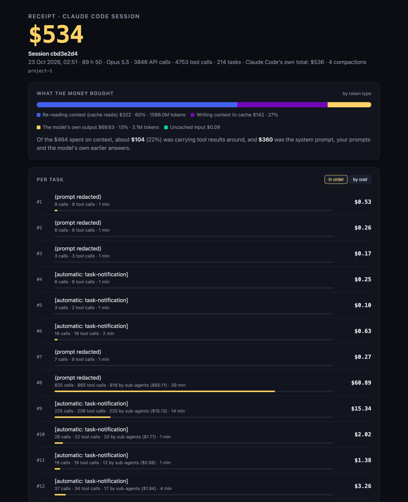

# ccreceipt

[](https://www.npmjs.com/package/ccreceipt-cli)
[](https://github.com/thehorizoncompany/ccreceipt-cli/actions/workflows/test.yml)
[](LICENSE)

**The itemized receipt for your Claude Code sessions**, and your OpenAI Codex CLI ones. What each task cost, which tool result you paid for 587 times, and what the same tokens would cost on another model. Local, zero dependencies, your sessions never leave your machine.

```
npx ccreceipt-cli
```

Works the same with `bunx ccreceipt-cli`, `pnpm dlx ccreceipt-cli` or `yarn dlx ccreceipt-cli`. Node 18+ or Bun, nothing to configure.

The npm package is `ccreceipt-cli`. Installed globally (`npm i -g ccreceipt-cli`), the command is simply `ccreceipt`; the examples below use that name.

```
  ──────────────────────────────────────────────────────────────
  RECEIPT · MERGE THE PRS INTO V1.01
  2026-10-23 00:51 · 89h50 · 3846 calls · 4753 tool calls
  ──────────────────────────────────────────────────────────────
  #161 also redo the visuals in English …                 $76.80
  #8 ok, before archiving I want …                        $60.89
  #84 for maplibre it's because we had talked about …     $25.24
  #79 do this: [pasted text] and fix it                   $16.59
  … 211 more tasks
  ──────────────────────────────────────────────────────────────
  Re-reading context (cache reads)                          $322
  Writing context to cache                                  $142
  Model output                                            $69.63
  Uncached input                                           $0.09
  ──────────────────────────────────────────────────────────────
  TOTAL                                                     $534
  (Claude Code's own total)                                 $536
  ──────────────────────────────────────────────────────────────
  Priciest tool result: visualize__read_me                 $0.73
    5445 tokens, re-read 587×
  Same tokens on Sonnet 5.5                                 $404
```

It then opens a single-file HTML report with the per-task receipt, the most expensive tool results, a per-tool table, the "same tokens, other model" table, and a scrubber to replay the session call by call with the running total.



## Terminal dashboard

`ccreceipt --tui` opens a full-screen dashboard in the terminal: every session on the left, the selected one's receipt on the right, in the colours of the product (night blue, bone, gold) with its pixel coffee cup while the sessions load.

```
↑ ↓  j k        select a session            Tab  ← →   overview, tasks, tools, models
PgUp PgDn       scroll the tasks or tools   Enter      write and open the HTML report
R               redact everything on screen A          claude, codex, all
Q  Esc  Ctrl+C  quit
```

It takes the same options as `--list` (`--agent`, `--dir`, `--since`, `--until`, `--pricing`, `--redact`) and needs a terminal of at least 80 × 24. Colours are 24-bit where the terminal says it supports them (`COLORTERM=truecolor`, iTerm2, WezTerm, Ghostty, VS Code, Windows Terminal), 256 colours otherwise, none with `NO_COLOR`.

## Sharing a receipt

`ccreceipt --redact` removes your prompts, Claude's replies, the session title, file paths, project and branch names from the terminal receipt, the HTML report and `--json`. Every number stays the same. The screenshot above was made that way.

`ccreceipt <id> --svg receipt.svg` writes the receipt as a 1200 px wide image, redacted by default. It opens in any browser and renders on GitHub. To post it on X, which does not take SVG, open it in a browser and take a screenshot, or convert it with any image tool.

## Why

`ccusage` tells you what you spent per day. `claude-replay` shows you what happened. Neither tells you **where** the money went inside a session: which prompt, which tool call, which 40 KB file you `cat`-ed in minute 3 and then paid to re-read on every one of the next 500 API calls. The receipt does.

Three numbers you cannot get elsewhere:

- **Cost per task.** Every prompt you typed, with everything it triggered (tool calls, sub-agents) priced and attributed to it.
- **Carrying cost of a tool result.** A result costs its tokens once to write to the cache, then its tokens × cache-read price on every later API call in the same context. Big *and* early is the expensive kind.
- **Same tokens, other model.** The identical token counts re-priced on Haiku 5.5, Sonnet 5.5, Opus 5.5, Opus 5 and Fable 5.1, so you can size the gap before switching.

## Usage

```
ccreceipt                 receipt for the most recent session (opens the HTML report)
ccreceipt <id-or-path>    a specific session: id, id prefix, or path to the .jsonl
ccreceipt --list          the 20 most recently active sessions with their cost
ccreceipt --all           totals across every session on this machine, and your most expensive tasks ever
ccreceipt --tui           interactive dashboard: browse every session and its receipt

--agent <name>      claude (default), codex, or all: whose sessions --list, --all
                    and the latest receipt read. A session id that is not a
                    Claude Code one is also looked up in Codex sessions
--out <file.html>   where to write the report (default: a temp file)
--json              the receipt as JSON
--no-open           do not open the browser
--limit <n>         rows for --list / --all (default 20)
--dir <path>        sessions directory (default ~/.claude/projects,
                    or ~/.codex/sessions with --agent codex)
--pricing <file>    JSON price overrides, USD per million tokens:
                    {"claude-opus-5-5": {"in": 4, "out": 20, "cr": 0.2}}
--since <date>      with --list / --all: sessions started on or after that day
                    (YYYY-MM-DD, local time) or in the last N days (7d)
--until <date>      with --list / --all: sessions started on or before that day
                    (YYYY-MM-DD, or 30d)
--redact            hide prompts, replies, titles, paths, project and branch names,
                    so the receipt can be shared; every number stays the same
--svg <file.svg>    write the receipt as an image to share instead of the HTML
                    report, redacted by default
--no-redact         with --svg: keep prompts, titles and names in the image
--no-update-check   do not check npm for a newer version (also NO_UPDATE_NOTIFIER=1)
-v, --version       print the version
-h, --help          print the help
```

A few examples:

```
ccreceipt --list --since 7d             what you spent this week
ccreceipt --all --since 2026-10-01      totals and priciest tasks since October 1
ccreceipt --list --agent all            Claude Code and Codex sessions together
ccreceipt 3f2a --svg receipt.svg        a shareable image of session 3f2a…
ccreceipt --json | jq .cost             the cost of the latest session, in USD
```

Requires Node 18+ or Bun. Reads `~/.claude/projects/*/<session>.jsonl` and the `<session>/subagents/` transcripts next to it, and with `--agent codex` the rollouts in `~/.codex/sessions`. No telemetry, no account.

## Update check

Once a day at most, ccreceipt asks the npm registry for the latest version of `ccreceipt-cli`. It is the only network request the CLI makes, and it sends nothing but the package name: no session data, no identifier. The request runs in the background and never slows a command down; when a newer version exists, one line at the end of the output says so on the next run:

```
  ccreceipt 0.3.0 is available (you have 0.2.1): npm i -g ccreceipt-cli
```

The answer is stored in `~/.cache/ccreceipt/update.json` (or `$XDG_CACHE_HOME/ccreceipt/`). There is no check in CI (`CI` set), when the output is not a terminal, with `--json`, with `--no-update-check`, or with `NO_UPDATE_NOTIFIER=1` in your environment. The CLI never updates itself.

## How the numbers are computed

- One API call = one assistant message id. Claude Code writes a message's content blocks as several lines that repeat the same `usage`; they are counted once.
- Cost = `input × in + cache writes × (1.25 × in for 5-minute entries, 2 × in for 1-hour entries) + cache reads × cr + output × out`, at Anthropic list prices (see `src/pricing.js`, checked 2026-10-30). Fast mode (`usage.speed: "fast"`) is billed at 2×.
- A task is everything between one of your prompts and the next. Sub-agent transcripts are attributed to the task that launched them (via the Agent tool call id in `agent-*.meta.json`).
- Tool result sizes are estimated at 4 characters per token (1,500 tokens per image). The carrying cost is an estimate built on that; the per-call totals are not estimates, they are the API's own `usage` figures.
- A compaction (`isCompactSummary`) empties the context: results before it stop being re-read.

**Accuracy.** Compared with the `cost-state` total Claude Code itself writes at the end of a session, on 41 sessions from one machine: 30 are within 2 %, the rest are 5 to 17 % *under*. The missing part is output Claude Code bills but does not write to disk: the Haiku model behind web search, and interrupted or retried responses. If you are on a Max/Pro plan, the dollars are what the same session would cost on the API, not what you paid.

## Codex sessions

`ccreceipt --agent codex` reads OpenAI Codex CLI sessions from `~/.codex/sessions` and prints the same receipt; `--agent all` lists both tools together. A Codex session id or a `rollout-*.jsonl` path also works without the flag.

- One call per model response (`token_usage_record`, deduped by response id). The sum matches the running token total Codex writes in the same file.
- `input_tokens` includes cached tokens: uncached input is priced at the input price, cached input at the cached-input price, output (reasoning included) at the output price.
- A task is a Codex turn, labelled with the first text you typed in it; the context Codex injects (environment, instructions, review history) is skipped.
- Prices are OpenAI's standard tier (see `src/pricing.js`, checked 2026-11-01). The surcharge for prompts over 272K tokens, Batch and Priority tiers are not applied. Models without a public price, such as `codex-auto-review`, are counted at $0 and named in the receipt.
- Older rollouts without `token_usage_record` fall back to `token_count` events.

## What it is not

Not a daily dashboard (use [ccusage](https://github.com/ccusage/ccusage)). Not a shareable video-like replay (use [claude-replay](https://github.com/es617/claude-replay)). Not a proxy (nothing to install in your shell, nothing to intercept). It reads files that are already on your disk and prints a receipt.

## Roadmap

The free CLI stays free. It reads Claude Code and OpenAI Codex sessions; Cursor comes if people ask. A paid Mac app on top of it, **ccreceipt Pro**, is in pre-order: live meter in the menu bar while a session runs, diff two sessions, one receipt across all sessions with per-project budgets and alerts, export for expense reports. Details and pre-order on the product page.

## License

Apache License 2.0. See `LICENSE` and `NOTICE`.

Forks and derived works must keep the `LICENSE` and `NOTICE` files. The name "ccreceipt" and its logo are trademarks and are not covered by the license: if you publish a fork, give it another name. See `TRADEMARKS.md`.
